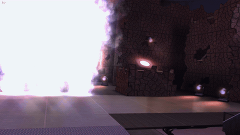
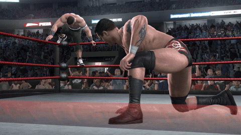
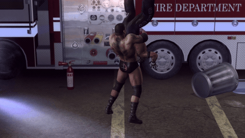
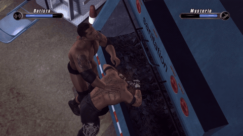
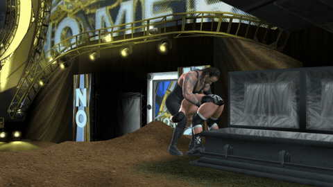

# WWE SmackDown vs. Raw 2008 — native PC, Linux & Steam Deck

The Xbox 360 version of **WWE SmackDown vs. Raw 2008**, recompiled to run natively on Windows, Linux
and the Steam Deck: no emulator, **60 fps**, up to **4K**.

**The goal is simple: bring the game back so people can play it again, natively on PC at 60 fps.**
It's the same game you remember, with no mods, roster changes or reworked gameplay: only what it needs
to run well on today's hardware.

> **You need your own copy of the game.** It runs from a disc image (`.iso`) of your own SvR 2008
> disc. None of the disc's files are in this project or its downloads, and it does not condone
> piracy: please buy the game.
>
> **Version 1.0, still updated.** Run into a problem?
> [Open an issue](https://github.com/nefariousjosiah/WWE-SVR2008-RECOMP/issues) with `game.log` from
> the game's folder, your graphics card and a screenshot.

## Showcase

<p align="center">
  
  
  
  
  
  
  
  
  
</p>

## Features

- **Native, not emulated:** the game's own code is recompiled for PC and drawn by a native renderer,
  Direct3D 12 on Windows and Vulkan on Linux and the Steam Deck.
- **60 fps,** using the game's own 60 fps mode so everything plays at the right speed.
- **480p up to 8K:** Auto picks 1440p on 1080p and 1440p screens, 4K on 4K screens and 720p on the
  Steam Deck; 480p helps weak graphics cards. The console's edge blur and its background blur (depth
  of field) are off for a sharp image; both are settings.
- **Smooth on lower-end PCs too:** no first-time stutters, and a GTX 1060 with an i7-8700 holds 60 fps.
- **Play in your language:** English, Español, Deutsch or Italiano. The disc has these translations,
  but the game only ever showed English.
- **Updates from inside the game,** only when you choose to; your saves are kept and backed up.
- **Controllers:** Xbox, PlayStation, Switch Pro and the Steam Deck's own.

<p align="center">
  
</p>

## Windows: install and play

1. Download **`SVR2008-NATIVE.zip`** from
   [Releases](https://github.com/nefariousjosiah/WWE-SVR2008-RECOMP/releases) (under *Assets*, not
   *Source code*).
2. Extract it to a folder of its own, for example `C:\Games\SVR2008-NATIVE` (not inside
   `Program Files`).
3. Copy your `.iso` into that folder, next to `svr2008.exe`.
4. Run **`svr2008.exe`**. If Windows warns, click *More info* > *Run anyway* (the program isn't
   code-signed).

**In game:** **F1** (or **Back + Start** on a controller, **Share + Options** on PlayStation) opens
the settings menu, and **F2** shows or hides the FPS counter. Your saves are in the `userdata`
folder: back it up to keep your career and created superstars.

You need Windows 10 or 11 (64-bit), a graphics card with Direct3D 12 or Vulkan (AMD, NVIDIA or
Intel, with a recent driver) and the USA / Europe release of the game (title ID `5451080B`, media
ID `5E35F037`, about 7.8 GB).

<details>
<summary><b>Settings, controllers and keyboard</b></summary>

- **The settings menu:** resolution (Auto, 480p, 720p, 1080p, 1440p, 4K, 8K), graphics API (Auto, Direct3D 12,
  Vulkan), fullscreen or window, 60 or 30 fps, screen shape, **Edge blur**, **Background blur**, FPS counter, sound, **Language**,
  keyboard controls, **Controllers**, CPU priority and updates. Saved in `svr2008.toml`.
- **Language:** the game's text and menus in English, Español, Deutsch or Italiano (the commentary is
  English only, and the SvR 2008 disc has no French). Pick one and press A twice to restart straight
  into it.
- **Controllers:** plug yours in before starting; each controller is its own player. Playing alone
  and the game says player 2 is disconnected, or your controller stops responding? A controller that
  reconnects, or shows up twice through Steam Input / DS4Windows / DSX, can become player 2: set
  **Controllers** to **All on player 1**.
- **Disc image somewhere else?** If there's no `.iso` in the folder, the game asks for one the first
  time and remembers it.
- **Keyboard controls** are included but not tested yet (a controller is recommended). The default
  layout (rebind with **F4** in game):

| Controller | Keyboard | | Controller | Keyboard |
|---|---|---|---|---|
| A | Space / ; | | Left stick | W A S D |
| B | Backspace / ' | | Right stick | Arrow keys |
| X | L | | D-pad | Shift + arrow keys |
| Y | P | | LB / RB | 1 / 3 |
| Start | Enter / X | | LT / RT | Q / E |
| Back | Tab / Z | | Stick presses | F / K |

</details>

## Linux and Steam Deck (Proton): install and play

The Windows release runs through Proton, Steam's compatibility layer: 720p at 60 fps on the Deck.

1. In **Desktop Mode**, download `SVR2008-NATIVE.zip`, extract it to a folder of its own (for example
   `/home/deck/Games/SVR2008-NATIVE`) and copy your `.iso` next to `svr2008.exe`.
2. In Steam: *Games* > *Add a Non-Steam Game to My Library...* > *Browse...*, set the file type to
   *All files* and pick `svr2008.exe`.
3. Right-click it > *Properties...* > *Compatibility*, tick *Force the use of a specific Steam Play
   compatibility tool* and choose **Proton Experimental**.
4. Back in **Game Mode**, start it from *Library* > *Non-Steam*.

<details>
<summary><b>More for the Steam Deck and Linux</b></summary>

- **Copying from your PC:** a USB stick must be **exFAT or NTFS** (the disc image is bigger than
  FAT32's 4 GB limit). A microSD card works too.
- **Other Linux PCs:** the same steps in Steam's desktop client, with up-to-date Vulkan drivers.
- **The first start** takes a little longer while Proton sets itself up.
- **Settings:** press **View + Menu** together. To use a back button instead: the game's
  *Controller settings* > *Edit Layout* > *Back Grip Buttons* > **L4** > *Keyboard* > **F1**.
- **Black bars:** the game is 16:9 and the Deck's screen 16:10; *Screen shape* > *Stretch to fill*
  in the settings menu fills it.
- **Quit** with the Steam button > *Exit game*. You can rename the shortcut (*WWE SmackDown vs. Raw
  2008*) and set its artwork in its properties.

</details>

## Updating

Open the settings menu, go to **Update** and press **A** to see what's new, **A** again to install,
then **Restart now**. Your `userdata` (saves, profiles, created superstars), settings and disc image
are kept, and your saves are also copied to `save_backups` first; if anything goes wrong, the version
you had is put back. **Check for updates: Off** keeps the game offline (the check only asks GitHub
for the latest release). Coming from v0.1? Download the new zip once by hand.

## Troubleshooting

| What happens | What to do |
|---|---|
| A window asks for a disc image | There's no `.iso` next to `svr2008.exe`: pick your disc image (it's remembered), or copy it into the game's folder. |
| The game closes right after starting | Check that your disc image is the USA / Europe release of SvR 2008 and complete. |
| Black screen, or the game closes | Update your graphics driver. Still happening: **F1** > *Graphics API* > the other one (or add `svr_graphics_api = "vulkan"` to `svr2008.toml`) and start again. |
| It runs slowly | Get the latest version. **F1** > *CPU priority* > **High** helps on a busy or weak PC; on a weak graphics card, **F1** > *Resolution* > **720p** (from the next start). |

Still stuck? [Open an issue](https://github.com/nefariousjosiah/WWE-SVR2008-RECOMP/issues) with
`game.log` from the game's folder, your processor and graphics card.

<details>
<summary><b>How it works</b></summary>

- **Recompilation.** [ReXGlue](https://github.com/rexglue/rexglue-sdk) translates the game's Xbox 360
  executable into C++ compiled for x86-64. The Xbox 360 system calls it makes are provided by the
  ReXGlue runtime, which also reads the game's data straight from your disc image.
- **Rendering.** Instead of emulating the Xbox 360 GPU, the renderer (adapted from
  [re:Blue](https://github.com/zolaware/reblue)) watches the game's own Direct3D library and draws the
  same scenes through [plume](https://github.com/zolaware/plume) on Direct3D 12 or Vulkan (two builds,
  `svr2008.exe` and `svr2008_vulkan.exe`; under Proton the first starts the second). The game's
  shaders are converted ahead of time with [XenosRecomp](https://github.com/zolaware/reblue-XenosRecomp),
  and the graphics pipelines are compiled in the background while each scene loads.
- **60 fps.** The game has its own 60 fps mode, which it normally drops to 30 for matches; a hook
  keeps it at 60, so the game logic and the animations stay in step.
- **Languages.** The disc has the game's text in English, Spanish, German and Italian, but this
  build of the game only lists English as available; the port adds the language you pick.

</details>

<details>
<summary><b>Building from source</b></summary>

For developers; players use the releases. Windows, with about 30 GB free.

```
git clone https://github.com/nefariousjosiah/WWE-SVR2008-RECOMP.git
cd WWE-SVR2008-RECOMP
powershell -ExecutionPolicy Bypass -File tools\windows\setup.ps1 -Iso "D:\path\to\your disc image.iso"
```

`setup.ps1` installs the tools it needs (Git, CMake, Ninja, LLVM clang, Python, 7-Zip, Visual Studio
2022 Build Tools), fetches the third-party sources at the pinned commits and applies this project's
patches (`patches/`), builds the ReXGlue SDK, extracts your disc image to `assets/`, recompiles
`default.xex` and builds the game.

The native renderer also needs your game's shaders, which can't be in this repository. The first
time, `setup.ps1` builds a shader-dump version and tells you how to collect them: play the menus
and a match or two with shader dumping on, run `tools\native\build_shader_cache.ps1`, then run
`setup.ps1` again.

Afterwards: `tools\windows\build.ps1` rebuilds, `tools\windows\run.ps1` runs it, and
`tools\windows\package_release.ps1` makes the release zip (the game, no game files; the version
number comes from `CMakeLists.txt`).

Repository layout: `src/` the game-specific code (`native/` renderer glue, `reblue/` the renderer),
`config/` recompiler configuration, `patches/` changes to the third-party sources, `tools/` build
scripts, `docs/` the images on this page.

</details>

## Credits

- [ReXGlue SDK](https://github.com/rexglue/rexglue-sdk) by Tom Clay, derived from
  [Xenia](https://xenia.jp): the recompiler and runtime.
- [re:Blue](https://github.com/zolaware/reblue) (Blue Dragon), the renderer this one is adapted
  from, with [plume](https://github.com/zolaware/plume) and
  [XenosRecomp](https://github.com/zolaware/reblue-XenosRecomp).
- [Dear ImGui](https://github.com/ocornut/imgui) with the Press Start 2P and Roboto fonts for the
  settings menu; [SDL](https://libsdl.org) for controllers and sound; [zstd](https://github.com/facebook/zstd).
- Inside the runtime: [FFmpeg](https://ffmpeg.org) (audio),
  [libmspack](https://github.com/kyz/libmspack) and the other libraries the ReXGlue SDK uses.

Licences of all of these: [THIRD_PARTY.md](THIRD_PARTY.md).

## Licence and legal

This project's own code, including the native renderer for SmackDown vs. Raw, was written by
nefariousjosiah and is licensed under the GNU General Public License v3.0 ([LICENSE](LICENSE)). The
releases are covered by the same licence, and this repository is their source. It builds on
re:Blue's renderer core (BSD 3-Clause) and the other projects in [THIRD_PARTY.md](THIRD_PARTY.md),
which keep their own licences; the releases include FFmpeg and libmspack under the LGPL (their
source: see THIRD_PARTY.md). None of the files from the game disc are in this repository or the
releases: the game's data (models, textures, sound, video) comes from your own disc image. The
releases do contain the game's program in recompiled form (`svr2008.exe`, with the game's shaders
converted for PC).

WWE, SmackDown vs. Raw and all related names, characters, content and the gameplay shown in the
showcase clips belong to their respective owners (WWE, THQ, Yuke's); the clips are used only to show
the port running. This is an unofficial fan project, not affiliated with or endorsed by them or by
Microsoft.
